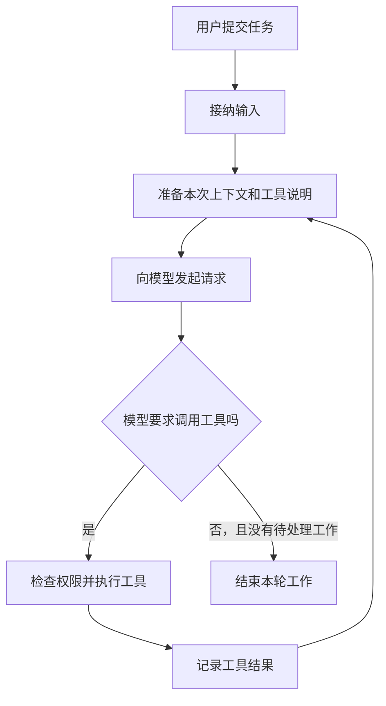

# Agent 架构导览：任务执行流程与核心概念

[总目录](README.md)

假设你让 Agent：“找出配置读取失败的原因，并修改代码。”它先读文件，再改文件，最后运行测试。模型负责判断下一步做什么，周围的程序负责把判断变成真实动作，并记录结果。

我们研究的 Harness，就是这层执行程序。你只需先理解下面这条路，不必先记三个项目的所有类名。

## 执行流程：输入、模型请求与工具调用

这是帮助阅读的公共草图，各项目的取消、重试和输入接纳规则会在正文展开。图中的“记录”也只表示接纳了结果；它是否已经写入稳定存储，要看第 07 篇。

模型第一次可能只要求读文件。程序把读取结果加入上下文，第二次模型才能根据文件内容决定怎样修改。所以，聊天界面上的“一次任务”，内部可能有很多次请求和工具调用。

## 核心概念：Session、Turn、Step 与 Attempt

| 词 | 阅读时先这样理解 | 容易弄混的地方 |
|---|---|---|
| Session / Thread | 持续保存身份和历史的一段会话 | 会话存在，不等于它正在运行 |
| Turn | 一轮工作的开始到收尾 | 不一定只含一次模型请求；DSH 甚至允许零 Step 的 Turn |
| Step | 向模型推进一步，通常还要处理它产生的工具调用 | 同一个逻辑 Step 可能有重试 |
| Attempt | 一次具体尝试，例如一次模型流 | 失败后再试，不一定要重新接纳用户输入 |

这些是阅读用的近似对应，三个项目没有统一的类型定义。遇到同名概念，仍要看它负责哪一段工作。`await` 表示暂时等待；等待期间，新输入、取消和插件更新都可能发生，很多设计问题正出现在这里。

## 八个研究主题与执行流程的对应关系

继续使用“读取配置、修改代码、运行测试”这个任务。

1. **第 01 篇：** 读文件时，你补充“不要修改生产配置”。这条新消息何时生效？
2. **第 02 篇：** 对话变长，需要压缩。模型下一次究竟看见哪些旧消息？
3. **第 03 篇：** 两个读取工具可以并行吗？按下停止后，已经启动的工具怎么办？
4. **第 04 篇：** 模型请求、流式输出和下一次请求如何衔接？Codex 看连接复用与增量请求，OpenCode 看断流重试，DSH 看实时输出与整次尝试的记录。
5. **第 05 篇：** 执行中更新工具插件。旧请求使用哪个版本，旧资源何时释放？
6. **第 06 篇：** 把测试交给子 Agent。父任务结束后，谁还负责子任务和它的结果？
7. **第 07 篇：** 文件已经改好，结果还没存下来就重启。系统知道多少，能安全重做什么？
8. **第 08 篇：** 最后结果错了。怎样分辨是模型判断、工具执行还是记录出了问题？

这样读，每篇研究的是同一趟任务中遇到的一种麻烦。

## 项目架构与源码入口

下面先说明三个项目各自从哪里进入。完整的模块图、逐步调用链、状态归属和代码阅读路径，分别见 [Codex 整体架构](codex/00-architecture.md)、[OpenCode 整体架构](opencode/00-architecture.md)、[DSH 整体架构](dsh/00-architecture.md)。

### Codex：交互入口与执行内核

仓库里有 CLI、TUI、app-server 等入口。它们周围有协议与交互代码，任务执行的关键路径进入 `codex-rs/core`。研究一次工作时，继续跟到 Session、`run_turn`、模型客户端和工具运行时；保存历史另看 `thread-store`。

读到 `StepContext`，先理解为“这次请求带着哪些设置和工具”；读到 `Arc`，先理解为多个异步任务共享持有这个对象。具体哪些字段固定、哪些权限仍需实时读取，由第 01 篇说明。

源码地图：[CLI 的入口类型](https://github.com/openai/codex/blob/a9b0815167c27ab13719dd12d13b63e02b70d221/codex-rs/cli/src/main.rs#L130-L180)、[Core 职责](https://github.com/openai/codex/blob/a9b0815167c27ab13719dd12d13b63e02b70d221/codex-rs/core/README.md)、[Turn 实现](https://github.com/openai/codex/blob/a9b0815167c27ab13719dd12d13b63e02b70d221/codex-rs/core/src/session/turn.rs)。

### OpenCode：输入接纳与执行协调

当前研究的是仓库 V2 的 `packages/core` 路径。`protocol` 定义对外操作，`schema` 定义数据和事件，`core` 管执行与保存，`server` 承担 HTTP 等传输。一次输入先进入持久收件箱，再唤醒执行协调器；Runner 决定下一步怎样推进。

读到 `Effect`，先把它当作带有依赖、错误和取消语义的异步计算。`Scope` 决定资源属于谁、何时清理；它会帮助你理解为什么后台任务不能跟着一个短命请求一起结束。

源码地图：[模块分工](https://github.com/anomalyco/opencode/blob/60a212c0769acd96b446acbadeb790486830f91d/specs/v2/README.md#L5-L18)、[输入与执行契约](https://github.com/anomalyco/opencode/blob/60a212c0769acd96b446acbadeb790486830f91d/specs/v2/session.md#L5-L80)。文档与实现有差异的地方，正文会指出。

### DSH：插件装配与默认驱动

DSH 使用 Cordis，把模型、工具、会话和默认循环都作为插件装配。启动配置选择 profile，再组合 bundles。换一个 profile，可能连持久化或遥测策略都不同；不能只看到某个接口，就认为所有启动方式都启用了它。

沿执行路径看：`core/agent` 定义 Agent 接口，`core/agent-loop` 提供默认驱动，`core/session` 记录事实并派生上下文，`core/tools` 执行工具。`ctx` 是当前插件能访问的服务与事件环境。

源码地图：[整体架构及默认执行顺序](https://github.com/deepseek-ai/deepseek-harness/blob/d743267388641bc76f17c45ce8b4c231aed1d32c/docs/architecture.md#L13-L124)、[能力接口与提供者](https://github.com/deepseek-ai/deepseek-harness/blob/d743267388641bc76f17c45ce8b4c231aed1d32c/docs/architecture.md#L130-L134)。

## 推荐阅读顺序

熟悉 TypeScript，可以选 [DSH 整体架构](dsh/00-architecture.md) 或 [OpenCode 整体架构](opencode/00-architecture.md)；熟悉 Rust，可以选 [Codex 整体架构](codex/00-architecture.md)。同一项目按 **00 → 01 → 03 → 04 → 02 → 07 → 05 → 06 → 08** 读，先确认模块如何协作，再研究执行主线和扩展功能。

读代码时先找 `// 笔记：` 注释。它们解释关键条件、状态变化以及等待期间可能发生什么；其他行是保留的上游代码。先把这段代码放回架构图，再读对应实现，避免把一个局部判断当成整个系统的保证。

第一遍只回答“发生了什么、为什么要这样做”。第二遍再对照源码，找出触发条件、等待点和状态变化。想检验自己是否真的读懂，先独立回答每篇末尾的问题，再展开参考答案。
