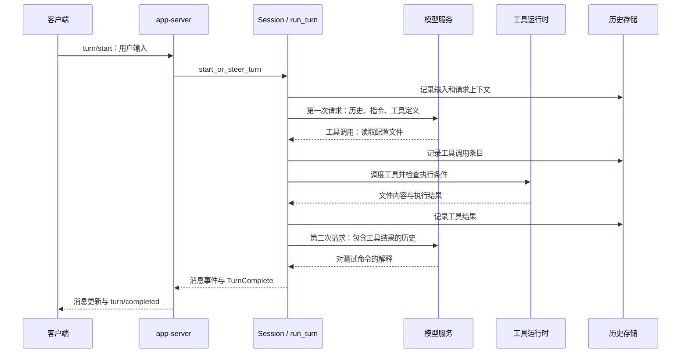
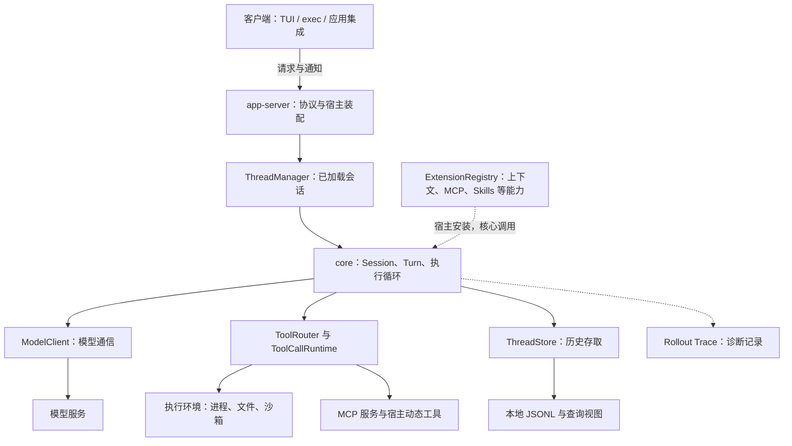

# Codex 00｜整体架构：宿主、会话内核与执行环境

[总目录](../README.md) · [公共导览](../START_HERE.md) · [本项目专题](01-agent-loop.md)

Codex 的主干是一个有状态的执行循环：**宿主接收用户任务，核心组织模型请求，工具改变或读取环境，结果进入历史，再交给模型继续。** 模型负责提出下一步；程序负责让这一步发生，并保存它的来龙去脉。

本篇以固定版本 `a9b0815167c27ab13719dd12d13b63e02b70d221` 的普通文本任务为主线。读完应能回答：请求从哪里进入，谁保存历史，谁执行工具，以及为什么一轮任务可以调用模型多次。实时语音、Guardian 审查等专用流程不在这条主线中。

## 一次任务的完整调用链

设一个已有会话收到：“读取项目的配置文件，解释测试命令。”下面假设模型选择调用 `exec_command` 读取文件，然后根据返回内容回答。这是沿源码构造的说明场景，没有实际请求模型。

图中存储箭头表示记录路径，不表示每一步都具有跨进程事务保证；下文会区分活动历史、持久记录和界面事件。真实流式输出也会在任务未结束时持续发送给客户端。

### 1. 宿主把输入交给会话

`app-server` 的消息处理器将 `turn/start` 交给 turn processor。processor 整理模型、权限、环境等设置，再调用 `CodexThread::start_or_steer_turn()`。`CodexThread` 是宿主使用的会话入口，内部持有真正工作的 `Session`。[请求分发](https://github.com/openai/codex/blob/a9b0815167c27ab13719dd12d13b63e02b70d221/codex-rs/app-server/src/message_processor.rs#L1643-L1660)、[提交输入](https://github.com/openai/codex/blob/a9b0815167c27ab13719dd12d13b63e02b70d221/codex-rs/app-server/src/request_processors/turn_processor.rs#L661-L699)、[会话入口](https://github.com/openai/codex/blob/a9b0815167c27ab13719dd12d13b63e02b70d221/codex-rs/core/src/codex_thread.rs#L208-L219)。

本例中会话空闲，因此核心创建 `TurnContext`，启动一个 `RegularTask`。如果会话已经在处理任务，同一入口可以把输入追加给活动 Turn；不是每条用户消息都必然新开一轮。任务接收成功也不等于模型已经读到输入。[开始或追加的分支](https://github.com/openai/codex/blob/a9b0815167c27ab13719dd12d13b63e02b70d221/codex-rs/core/src/session/turn_input.rs#L328-L454)。

### 2. 核心准备第一次模型请求

`RegularTask::run()` 调用 `run_turn()`。后者准备本轮输入和执行上下文；输入被记录后，才形成模型请求。请求使用的 `StepContext` 包含本次模型设置、环境、MCP 绑定和工具路由。接着，程序将会话历史转换为模型能够接收的输入，调用 `run_sampling_request()`。[任务进入循环](https://github.com/openai/codex/blob/a9b0815167c27ab13719dd12d13b63e02b70d221/codex-rs/core/src/tasks/regular.rs#L101-L126)、[首轮输入记录](https://github.com/openai/codex/blob/a9b0815167c27ab13719dd12d13b63e02b70d221/codex-rs/core/src/session/turn.rs#L365-L377)、[请求准备](https://github.com/openai/codex/blob/a9b0815167c27ab13719dd12d13b63e02b70d221/codex-rs/core/src/session/turn.rs#L418-L541)。

`run_sampling_request()` 将输入、基础指令、工具定义组织成 `Prompt`，通过 `ModelClientSession::stream()` 请求模型。这里才进入网络通信；前面的输入排队和上下文构造都是本地运行逻辑。[Prompt 构造](https://github.com/openai/codex/blob/a9b0815167c27ab13719dd12d13b63e02b70d221/codex-rs/core/src/session/turn.rs#L1624-L1684)、[流请求](https://github.com/openai/codex/blob/a9b0815167c27ab13719dd12d13b63e02b70d221/codex-rs/core/src/session/turn.rs#L2561-L2580)。

### 3. 模型提出调用，程序执行工具

响应流中出现完整工具调用条目后，`handle_output_item_done()` 用 `ToolRouter::build_tool_call()` 解析它，先记录调用，再交给 `ToolCallRuntime`。执行器继续持有公布这项工具时的 `StepContext`，依据这份路由找到实际 handler。[识别与排队](https://github.com/openai/codex/blob/a9b0815167c27ab13719dd12d13b63e02b70d221/codex-rs/core/src/stream_events_utils.rs#L315-L356)、[路由与调度](https://github.com/openai/codex/blob/a9b0815167c27ab13719dd12d13b63e02b70d221/codex-rs/core/src/tools/parallel.rs#L127-L159)。

以 `exec_command` 为例，下面还有进程管理、审批策略和沙箱选择。`ToolOrchestrator` 组织这些检查，再让具体 runtime 执行命令。模型能写出工具调用，只代表它提出了一项请求；不代表文件访问或命令执行已经获准。[命令进入执行层](https://github.com/openai/codex/blob/a9b0815167c27ab13719dd12d13b63e02b70d221/codex-rs/core/src/unified_exec/process_manager.rs#L1462-L1545)。

### 4. 工具结果成为下一次请求的输入

采样流程收集工具 future（待完成的异步工作），将完成结果写入会话历史。直接工具调用的结果由 `FuturesOrdered` 按排队顺序收集；实际执行可以重叠。**先完成的工具与先进入历史的结果，不一定是同一个。** 本例只有一个读文件调用，结果随后就可供下一请求使用。[结果收集与记录](https://github.com/openai/codex/blob/a9b0815167c27ab13719dd12d13b63e02b70d221/codex-rs/core/src/session/turn.rs#L2462-L2489)。

调用工具会令采样结果标记 `needs_follow_up`。`run_turn()` 检查这个标记和待处理输入，决定继续；下一次循环重新组织历史并捕获请求所需状态。因此，读文件与解释文件通常属于**同一 Turn 内的两次模型请求**，而不是两个独立用户任务。[工具触发续接](https://github.com/openai/codex/blob/a9b0815167c27ab13719dd12d13b63e02b70d221/codex-rs/core/src/stream_events_utils.rs#L345-L357)、[继续条件](https://github.com/openai/codex/blob/a9b0815167c27ab13719dd12d13b63e02b70d221/codex-rs/core/src/session/turn.rs#L545-L579)。

### 5. 核心完成任务，宿主更新界面

普通流程中，没有待续接工作、结束 hooks 也未要求补充处理时，执行循环返回，任务层统一收尾。`on_task_finished()` 产生 `TurnComplete`，清理相应活动状态。Session 通过事件通道通知宿主；app-server 的监听器读取 `next_event()`，更新自己的轮次视图，再把核心事件翻译为 `turn/completed` 等协议通知。[结束前的 hooks](https://github.com/openai/codex/blob/a9b0815167c27ab13719dd12d13b63e02b70d221/codex-rs/core/src/session/turn.rs#L657-L708)、[任务收尾](https://github.com/openai/codex/blob/a9b0815167c27ab13719dd12d13b63e02b70d221/codex-rs/core/src/tasks/mod.rs#L819-L885)、[事件监听](https://github.com/openai/codex/blob/a9b0815167c27ab13719dd12d13b63e02b70d221/codex-rs/app-server/src/request_processors/thread_lifecycle.rs#L323-L389)、[完成通知](https://github.com/openai/codex/blob/a9b0815167c27ab13719dd12d13b63e02b70d221/codex-rs/app-server/src/bespoke_event_handling.rs#L1330-L1353)。

所以“界面显示完成”是一条任务生命周期通知，不是对解释内容正确性的证明。测试命令是否解释准确，仍要用实际文件内容或验收要求判断。

## 模块如何分工

先分清三个层次：客户端面对用户；app-server 面对客户端协议并装配功能；core 面对任务执行。模型服务和执行环境位于不同方向，分别提供推理与实际行动。

图中的箭头表示职责间调用或数据传递，不要求每一格都是独立进程。比如这个版本的 `codex exec` 就使用进程内 app-server client。[exec 的实际入口](https://github.com/openai/codex/blob/a9b0815167c27ab13719dd12d13b63e02b70d221/codex-rs/exec/src/lib.rs#L1020-L1026)。顶层 CLI 负责选择交互界面、exec、app-server 等模式；不能把 CLI 参数处理器当作 Agent 循环。[CLI 分发](https://github.com/openai/codex/blob/a9b0815167c27ab13719dd12d13b63e02b70d221/codex-rs/cli/src/main.rs#L1095-L1188)。

| 模块 | 在任务中的责任 | 源码入口 |
|---|---|---|
| app-server | 将客户端请求转成核心操作，把核心事件转成客户端通知，安装宿主能力 | `app-server/src/message_processor.rs`、`request_processors/turn_processor.rs` |
| ThreadManager / CodexThread | 创建和维护已加载会话，向宿主提供提交输入与读取事件的入口 | `core/src/thread_manager.rs`、`codex_thread.rs` |
| Session / RegularTask | 保有会话状态，管理活动任务，把模型、工具、历史连接成循环 | `core/src/session/`、`tasks/regular.rs` |
| ModelClient | 处理模型传输、连接缓存与续接；不负责操作工作区文件 | `core/src/client.rs` |
| 工具层与执行环境 | 从调用名称找到 handler，控制并发和取消；需要时审批、选择沙箱并执行进程或文件操作 | `core/src/tools/`、`unified_exec/`、`exec-server/` |
| ThreadStore | 给核心提供存取接口；本地实现管理历史文件及查询投影 | `thread-store/src/local/` |
| ExtensionRegistry | 按上下文、输入、工具生命周期等职责提供接入点 | `ext/extension-api/src/registry.rs` |

各职责不是仅由目录名猜测：`ThreadManager` 明确负责内存中的会话；Session 的服务集合持有模型客户端、存储、扩展和执行环境；exec-server 则拥有进程与文件处理器。[管理器职责](https://github.com/openai/codex/blob/a9b0815167c27ab13719dd12d13b63e02b70d221/codex-rs/core/src/thread_manager.rs#L250-L255)、[核心服务集合](https://github.com/openai/codex/blob/a9b0815167c27ab13719dd12d13b63e02b70d221/codex-rs/core/src/state/service.rs#L51-L105)、[执行服务边界](https://github.com/openai/codex/blob/a9b0815167c27ab13719dd12d13b63e02b70d221/codex-rs/exec-server/README.md#L1-L15)。

## 状态与生命周期：会话、轮次、请求

同一段工作会同时出现几个带“上下文”或“会话”的名字。区分它们，关键是问：**这个对象要陪哪一段工作活多久？**

| 名称 | 保存什么、存在多久 | 不应混淆成什么 |
|---|---|---|
| Thread / Thread ID | 会话身份与可持久保存的历史；卸载后仍可用同一身份恢复 | 一直运行的操作系统线程 |
| CodexThread / Session | 当前已加载会话的接口与运行状态；Session 持有历史、输入队列、服务和活动 Turn | 每次模型请求都新建的对象 |
| TurnContext / ActiveTurn | 一轮工作的配置、身份、授权，以及当前任务句柄、取消信号和等待项 | 一条消息或一次模型调用 |
| StepContext | 一次采样请求所用的设置、环境视图、工具路由与 MCP 绑定 | 永不变化的整个 Session 快照 |
| ModelClientSession | 服务一个 Turn 的模型通信对象，包含本轮路由令牌 | 上面的业务 Session |

这些归属可直接从 [Session 字段](https://github.com/openai/codex/blob/a9b0815167c27ab13719dd12d13b63e02b70d221/codex-rs/core/src/session/session.rs#L60-L100)、[活动任务与等待项](https://github.com/openai/codex/blob/a9b0815167c27ab13719dd12d13b63e02b70d221/codex-rs/core/src/state/turn.rs#L29-L111)、[StepContext 字段](https://github.com/openai/codex/blob/a9b0815167c27ab13719dd12d13b63e02b70d221/codex-rs/core/src/session/step_context.rs#L23-L48)中核对。

一次普通任务先有 Turn，里面先后准备 Step 1、Step 2……；工具 runtime 用 `Arc` 共享持有它来源的 Step。即使后续设置改变，旧调用仍能找到当时的工具解释。权限又有自己的寿命：Step 访问环境时，会结合所属 Turn 当前的 grants；不能据此认为授权也被永远冻住。[请求视图与动态授权](https://github.com/openai/codex/blob/a9b0815167c27ab13719dd12d13b63e02b70d221/codex-rs/core/src/session/step_context.rs#L62-L73)。

Session 中只有一个 `active_turn` 槽位，但这不等于系统只能做一件事。同一请求中的可并行工具能重叠执行，子 Agent 有各自的 Session，Code Mode（由代码编排工具调用）的后台工作也可能保留原 Turn 的状态。各自的锁与取消信号解决各自范围的问题，不是整个工作区的一把总锁。[活动槽位](https://github.com/openai/codex/blob/a9b0815167c27ab13719dd12d13b63e02b70d221/codex-rs/core/src/session/session.rs#L90-L96)、[工具运行时的锁](https://github.com/openai/codex/blob/a9b0815167c27ab13719dd12d13b63e02b70d221/codex-rs/core/src/tools/parallel.rs#L45-L65)、[后台工作保留 Turn 授权](https://github.com/openai/codex/blob/a9b0815167c27ab13719dd12d13b63e02b70d221/codex-rs/core/src/session/turn_context.rs#L377-L382)。

模型连接也是单独一层：外层 `ModelClient` 属于会话；每轮创建新的 `ModelClientSession`，却可以接回缓存的 WebSocket 和合法续接状态。每轮清空的是 `turn_state` 路由令牌，而不是所有连接状态。详见[模型通信](04-llm-streaming.md)。

## 历史、存储与界面事件分别承担什么

模型上下文和界面通知并不是同一种数据。比如工具启动事件可以让界面显示“执行中”，但下一次模型请求需要的是工具调用和输出条目，而不只是这条界面提示。

| 数据 | 主要消费者 | 保存与转换位置 |
|---|---|---|
| 活动历史中的 `ResponseItem` | 下一次模型请求 | Session 的历史管理器记录条目，构造请求时通过 `for_prompt()` 取得模型输入 |
| `RolloutItem` 历史记录 | 会话恢复、历史查询 | Session 交给 `LiveThread` / `ThreadStore`；本地后端以 JSONL 为历史依据 |
| `EventMsg` 及协议通知 | app-server 与客户端 | Session 发事件，app-server 翻译成具体通知；事件是否入历史还受存储策略控制 |
| Rollout Trace | 离线诊断程序 | 可选记录；失败可以禁用，不是恢复会话的主账本 |

`record_prepared_conversation_items()` 先更新活动历史，再构造对应 `RolloutItem` 交给保存接口；两份状态并非一个数据库事务。[活动历史与保存](https://github.com/openai/codex/blob/a9b0815167c27ab13719dd12d13b63e02b70d221/codex-rs/core/src/session/mod.rs#L3710-L3741)。默认事件发送路径也会先尝试保存，再投递事件，但保存失败会被记录下来，不能把“收到事件”当成强持久性证明。[保存与事件投递](https://github.com/openai/codex/blob/a9b0815167c27ab13719dd12d13b63e02b70d221/codex-rs/core/src/session/mod.rs#L2673-L2702)、[保存失败的返回](https://github.com/openai/codex/blob/a9b0815167c27ab13719dd12d13b63e02b70d221/codex-rs/core/src/session/mod.rs#L4628-L4636)。

本地 `ThreadStore` 先写 JSONL，再更新可重建的 SQLite 历史视图。视图可以因失败而暂时落后，不能先于实际历史。文件 flush 的边界、受管理重启如何选取可继续任务，见[任务恢复](07-persistence-reliability.md)；诊断记录与任务验收的区别，见[可观测性](08-observability-evaluation.md)。[本地写入顺序](https://github.com/openai/codex/blob/a9b0815167c27ab13719dd12d13b63e02b70d221/codex-rs/thread-store/src/local/live_writer.rs#L327-L383)。

## 扩展、权限与子 Agent 接到哪里

**扩展接在宿主与核心之间。** app-server 的 `thread_extensions()` 安装队列、记忆、MCP、Skills 等模块，核心只调用约定能力。给请求补上下文与提供 MCP 服务，是两种不同注册入口。这里的 extension 是进程内 Rust 装配接口；MCP 是与工具服务通信的机制，Skills 则通过专用模块参与能力与指令组织，三者不能当作同一个“插件系统”。[宿主安装](https://github.com/openai/codex/blob/a9b0815167c27ab13719dd12d13b63e02b70d221/codex-rs/app-server/src/extensions.rs#L50-L121)、[分职责注册](https://github.com/openai/codex/blob/a9b0815167c27ab13719dd12d13b63e02b70d221/codex-rs/ext/extension-api/src/registry.rs#L112-L125)。

**权限落在实际行动路径上。** 工具目录告诉模型“可以提出哪些调用”；审批策略回答“这次调用是否获准”；并发门决定“什么时候执行”；沙箱限制“执行时能访问什么”。一个工具进入目录，不会取消后面三项约束。具体取消与审批流程见[工具执行](03-tools-sandbox.md)。

**子 Agent 仍然是一条可继续的会话。** 多 Agent V2 通过 `AgentControl` 管理身份、父子关系和消息递送，通过 ThreadManager 管理已加载的执行对象。恢复根任务时可以只恢复孩子的元数据，真正发送工作时再按需加载；因此 `Unloaded` 不表示删除。[身份恢复](https://github.com/openai/codex/blob/a9b0815167c27ab13719dd12d13b63e02b70d221/codex-rs/core/src/agent/control/spawn.rs#L190-L274)、[发送前加载](https://github.com/openai/codex/blob/a9b0815167c27ab13719dd12d13b63e02b70d221/codex-rs/core/src/agent/control/api.rs#L112-L120)。

由父对象恢复子会话时，还检查父对象是否就是当前登记实例、是否运行、是否属于同一个任务注册表。新子任务不是任意复制一份提示词就完事，它还需要明确授权、环境和生命周期的归属。详见[子 Agent 编排](06-task-orchestration.md)。[父对象校验](https://github.com/openai/codex/blob/a9b0815167c27ab13719dd12d13b63e02b70d221/codex-rs/core/src/agent/control/spawn.rs#L326-L338)。

## 阅读路径与自测

第一次读按“正常执行 → 长任务 → 宿主能力”前进：

1. [执行循环](01-agent-loop.md) → [工具执行](03-tools-sandbox.md) → [模型通信](04-llm-streaming.md)：跟完用户输入、模型调用、工具结果回到模型的闭环。
2. [上下文管理](02-context-session.md) → [任务恢复](07-persistence-reliability.md)：理解历史变长和进程重启后，程序保留什么、重建什么。
3. [扩展架构](05-extension-architecture.md) → [子 Agent 编排](06-task-orchestration.md) → [可观测性](08-observability-evaluation.md)：理解宿主如何增加能力、分配工作和调查问题。

阅读源码时先沿本篇五步调用链走一遍，再打开相关模块；不必从巨大的 `session/mod.rs` 第一行连续读到最后。

**练习：** 模型完成读取配置文件的调用，界面已经显示工具结束，但尚未发出最后解释。请标出：此时哪个 Turn 仍在工作，结果在哪里等待下一次请求，以及 UI 更新和模型输入分别走哪条路径。再回答：如果此时把会话卸载，恢复后是否能直接接着原来的 Rust future 执行？

参考答案

普通路径仍在原 Turn 中。直接工具结果由采样流程收集并记录到 Session 历史，下一次采样把历史转换为 Prompt；工具完成事件则通过 Session 事件通道到 app-server，再变为客户端通知。事件已显示不能单独证明后续模型请求已消费结果。

卸载与恢复保存的是会话身份、历史和相关配置，不保存 Rust future 的执行位置。是否可以卸载、是否需要等待工作结束有专门规则；满足恢复条件后也是重建执行对象。工具已经发生的文件副作用，更不能由恢复历史自动回滚。

证据范围：本篇来自固定源码的静态调用链复核；没有运行上游构建、模型请求或重启实验。研究入口与关键边界的逐项记录见[架构重读记录](../research/reread/codex-architecture.md)。
