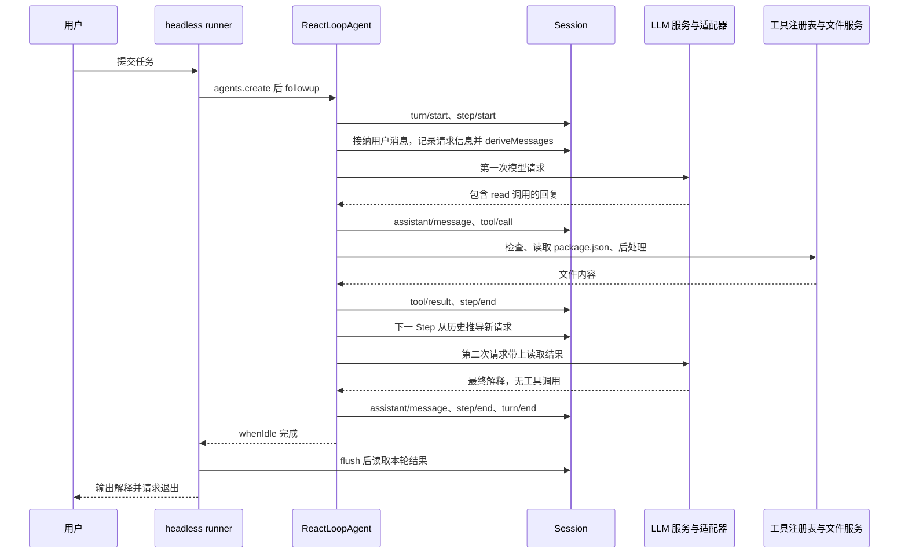
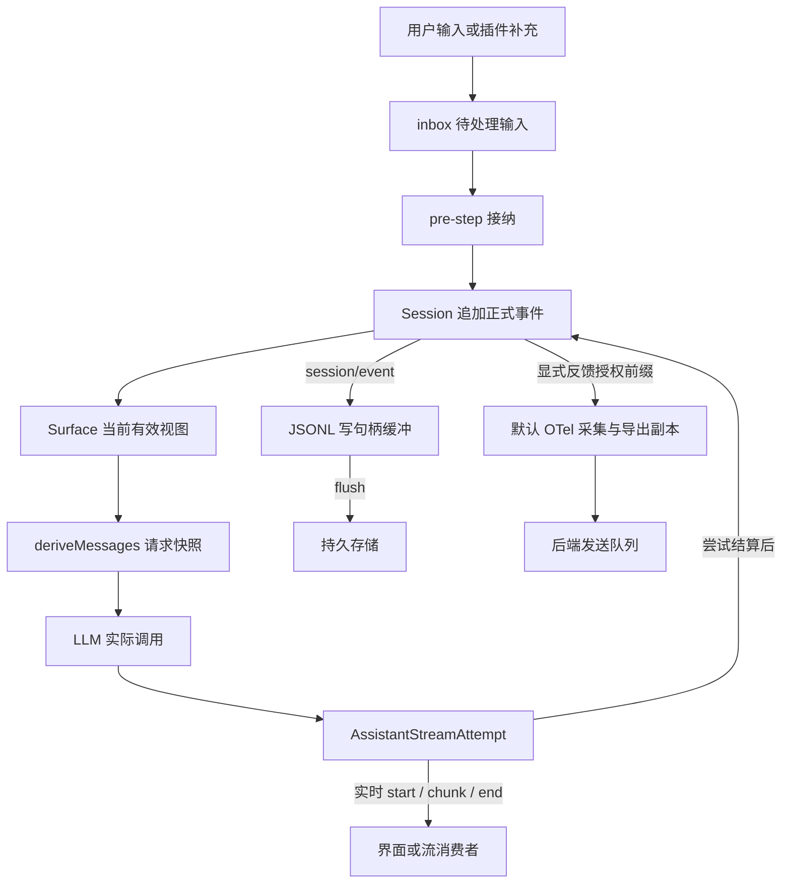

# DSH 00｜整体架构：插件装配与任务执行链

[总目录](../README.md) · [公共导览](../START_HERE.md) · [本项目专题](01-agent-loop.md)

DeepSeek Harness（DSH）把一个 Agent 产品拆成可以组合的插件：启动器决定装哪些能力，循环驱动决定什么时候工作，Session 保存工作记录，模型和工具服务完成实际调用。理解它的重点，是跟着一次任务看这些部分怎样交接。

本文以固定版本 `d743267388641bc76f17c45ce8b4c231aed1d32c` 的 **headless profile + 默认 ReactLoopAgent** 为主线。headless 是命令行一次性执行模式，适合观察完整过程。Web、SDK、ACP 有不同入口；profile 还可被用户补丁改变，不能把下面的装配当作所有部署都具有的能力。

## 一次正常任务：读取配置并解释测试命令

设用户提交“读取 package.json，解释测试命令，不要修改文件”，模型先调用 `read`，读完后再给最终回答。这里假设请求与读取均成功，不触发重试。



上图是这条成功路径的教学概括，具体交接有六步：

1. **入口把任务交给 Agent。** `headless.run()` 从参数或标准输入取得文本，读取默认模型选择，调用 `agents.create()` 得到 Agent，再调用 `followup()`。应用入口关心“提交、等待、读取结果”，无需自己实现模型循环。[入口源码](https://github.com/deepseek-ai/deepseek-harness/blob/d743267388641bc76f17c45ce8b4c231aed1d32c/packages/bundle/headless/src/index.ts#L327-L378)
2. **驱动领取输入并准备一个 Step。** `followup → send → wakeDriver → kick → turn` 打开 Turn；`preStep()` 领取输入、组装系统提示与工具定义，并经过 `agent/pre-step` 拦截器。接纳后才写 `step/start`。插件可以改写或拒绝输入，但正常路径继续向下。[驱动与准备](https://github.com/deepseek-ai/deepseek-harness/blob/d743267388641bc76f17c45ce8b4c231aed1d32c/packages/core/agent-loop/src/agent.ts#L154-L234)、[Step 接纳](https://github.com/deepseek-ai/deepseek-harness/blob/d743267388641bc76f17c45ce8b4c231aed1d32c/packages/core/agent-loop/src/agent.ts#L252-L340)
3. **把本次请求的依据记清，再调用模型。** `prepareRequest()` 经过 `agent/request`，绑定模型调用；`step()` 根据该模型的能力安排系统提示，追加接纳的用户输入。`buildRequest()` 记录请求头和运行上下文，从 `session.deriveMessages()` 取得模型历史，再冻结本次请求。新输入在这里正式进入模型上下文，排进 inbox 时还不算。[请求准备与绑定](https://github.com/deepseek-ai/deepseek-harness/blob/d743267388641bc76f17c45ce8b4c231aed1d32c/packages/core/agent-loop/src/agent.ts#L400-L453)、[请求快照](https://github.com/deepseek-ai/deepseek-harness/blob/d743267388641bc76f17c45ce8b4c231aed1d32c/packages/core/agent-loop/src/agent.ts#L669-L703)
4. **模型回复先结算，再执行其中的工具调用。** `AssistantStreamAttempt` 积累流片段并发布实时通知；正常结束时，整次回复作为 `assistant/message` 加入 Session。驱动提取其中的 tool-call，交给 `executeToolCalls()`；工具注册表完成前置检查、实际调用与后处理，`read` 再通过 `ctx.fs` 读取文件。[回复与工具分派](https://github.com/deepseek-ai/deepseek-harness/blob/d743267388641bc76f17c45ce8b4c231aed1d32c/packages/core/agent-loop/src/agent.ts#L529-L555)、[工具检查](https://github.com/deepseek-ai/deepseek-harness/blob/d743267388641bc76f17c45ce8b4c231aed1d32c/packages/core/tools/src/index.ts#L1499-L1543)、[文件读取](https://github.com/deepseek-ai/deepseek-harness/blob/d743267388641bc76f17c45ce8b4c231aed1d32c/packages/fs/tool-fs/src/read.ts#L137-L147)
5. **读取结果进入 Session，触发下一次推理。** 调度器把文件内容记为 `tool/result`，加入 Surface。普通工具完成后，`step()` 返回 `null`，表示这一 Turn 还需要下一次请求。下一 Step 重新从 Session 推导消息，所以模型能看见原要求、自己的 read 调用和文件内容。它据此给出解释，没有工具调用则返回 completed。[结果追加](https://github.com/deepseek-ai/deepseek-harness/blob/d743267388641bc76f17c45ce8b4c231aed1d32c/packages/core/agent-loop/src/tool-calls.ts#L270-L289)、[是否继续](https://github.com/deepseek-ai/deepseek-harness/blob/d743267388641bc76f17c45ce8b4c231aed1d32c/packages/core/agent-loop/src/agent.ts#L547-L555)
6. **循环结束后，应用完成自己的收尾。** 驱动写 `step/end`，经过停止钩子，确认没有新 next-step 输入后写 `turn/end`。headless 不仅等待父 Agent 空闲，还检查子任务是否稳定；随后 `sessions.flush()`，从本轮日志汇总文本并请求退出。启动器负责卸载插件树。[Turn 收尾](https://github.com/deepseek-ai/deepseek-harness/blob/d743267388641bc76f17c45ce8b4c231aed1d32c/packages/core/agent-loop/src/agent.ts#L356-L397)、[headless 收尾](https://github.com/deepseek-ai/deepseek-harness/blob/d743267388641bc76f17c45ce8b4c231aed1d32c/packages/bundle/headless/src/index.ts#L379-L403)

这个例子是 **一个 Turn、两个 Step，每个 Step 一次 Attempt**。Turn 是一次被唤醒后的工作边界；Step 是一次模型请求及其工具执行；Attempt 是实际模型尝试，重试会让一个 Step 有多个 Attempt。Goal 的自动 Round 还在外面一层：它提交下一条续跑消息，不是替代 Step 的另一种模型循环。

入口的等待代码能看出应用层还有什么责任。下面代码中的 `// 笔记：` 是新增的中文讲解，其余行保留上游原文：

<!-- annotated-source: https://github.com/deepseek-ai/deepseek-harness/blob/d743267388641bc76f17c45ce8b4c231aed1d32c/packages/bundle/headless/src/index.ts#L379-L390 -->
```ts
      // 笔记：入口还要考虑子任务；父 Agent 短暂空闲不一定意味着整项工作结束。
      const subagents = ctx.get('subagents')
      while (true) {
        await agent.whenIdle()
        const idleSeq = agent.session.seq
        // Child settlement can wake the parent before the child wait observes it.
        // 笔记：等待子任务可能重新唤醒父任务，所以同时检查状态和日志是否变化。
        if (!await subagents?.waitForChildren(agent)
          && agent.status === 'idle' && agent.session.seq === idleSeq) break
      }
    } finally {
      stopReasoning?.()
    }
    // 笔记：循环稳定后还要等待保存；whenIdle 本身不作磁盘持久性承诺。
    await sessions.flush(agent.session)
```

## 启动装配：profile 决定这次运行有哪些能力

上面的服务不是由一个巨大构造函数全部写死的。`apps/cli/src/bin.ts` 解析 `dsh --profile headless ...` 后调用 `runProfile()`；后者加载 profile 和补丁，通过 `boot()` 创建 Cordis `Context`、挂载 Loader，等插件树完成加载并审查必要插件是否正常激活。[CLI 分派](https://github.com/deepseek-ai/deepseek-harness/blob/d743267388641bc76f17c45ce8b4c231aed1d32c/apps/cli/src/bin.ts#L26-L48)、[启动实现](https://github.com/deepseek-ai/deepseek-harness/blob/d743267388641bc76f17c45ce8b4c231aed1d32c/apps/cli/src/profile-boot.ts#L265-L319)、[boot](https://github.com/deepseek-ai/deepseek-harness/blob/d743267388641bc76f17c45ce8b4c231aed1d32c/packages/boot/app-boot/src/index.ts#L975-L1016)

**profile 是运行配方，bundle 是一组可以覆盖的插件配置。** headless 模板先装 `dsh-base`，再装 `dsh-headless`；base 提供循环、模型、工具、会话、存储和策略等共用部分，headless 增加一次性执行入口，不挂 Web 服务器。Web、SDK、ACP 模板也基于 base；`sdk-minimal` 则只有自己的独立 bundle。[模板列表](https://github.com/deepseek-ai/deepseek-harness/blob/d743267388641bc76f17c45ce8b4c231aed1d32c/packages/boot/app-boot/src/profile.ts#L178-L195)、[headless bundle](https://github.com/deepseek-ai/deepseek-harness/blob/d743267388641bc76f17c45ce8b4c231aed1d32c/packages/bundle/headless/cordis.patch.yml#L1-L33)

普通配置层按以下次序覆盖：bundle 列表 → profile 自己的补丁 → Harness home 的补丁 → 命令行 `--patch`。启动器最后还会应用遥测禁用开关。补丁按配置行 ID 定位，替换该行的整个 `config`；这不是任意深度合并。[配置层合成](https://github.com/deepseek-ai/deepseek-harness/blob/d743267388641bc76f17c45ce8b4c231aed1d32c/packages/boot/app-boot/src/profile-context.ts#L63-L74)、[配置覆盖说明](https://github.com/deepseek-ai/deepseek-harness/blob/d743267388641bc76f17c45ce8b4c231aed1d32c/packages/bundle/base/cordis.patch.yml#L1-L13)

Cordis 的依赖注入解决“插件什么时候能工作”：插件声明需要 `sessions`、`tools` 等服务，依赖可用后才激活，通过 `ctx` 取得服务。**配置覆盖顺序与插件激活顺序不是一回事；不能靠把 YAML 行移到前面保证依赖就绪。** 注册服务、监听事件等动作归所属插件生命周期管理，卸载时撤销相应注册。

默认驱动的依赖声明直接列出了它要协调的对象：

<!-- annotated-source: https://github.com/deepseek-ai/deepseek-harness/blob/d743267388641bc76f17c45ce8b4c231aed1d32c/packages/core/agent-loop/src/index.ts#L342-L342 -->
```ts
  // 笔记：循环协调这些服务；它不自己承担模型协议、文件存储和工具能力的所有实现。
  static inject = ['agents', 'sessions', 'llm', 'tools', 'systemPrompt', 'sessionProjections']
```

`agent.ctx` 还提供单个 Agent 的作用域。这样，一个 Agent 注册的能力可以跟随它撤销。需要把某个服务实例也隔离时，还要正确配置隔离域；“有作用域”不等于底下所有对象都自动独立。执行环境的成套替换继续看[扩展架构](05-extension-architecture.md)。

## 组件协作：接口、驱动与服务各管哪一段

先区分容易混淆的两个名字。`core/agent` 定义公共 `Agent` 接口并维护 `AgentRegistry`；`core/agent-loop` 是默认实现，注册创建工厂并实例化 `ReactLoopAgent`。入口调用 `ctx.agents.create()` 时，注册表把调用交给工厂，而不是在公共接口层写死循环。更换驱动需要实现相同契约，不能只换类名。[工厂注册](https://github.com/deepseek-ai/deepseek-harness/blob/d743267388641bc76f17c45ce8b4c231aed1d32c/packages/core/agent-loop/src/index.ts#L365-L388)、[公共创建入口](https://github.com/deepseek-ai/deepseek-harness/blob/d743267388641bc76f17c45ce8b4c231aed1d32c/packages/core/agent/src/index.ts#L382-L415)、[实例化位置](https://github.com/deepseek-ai/deepseek-harness/blob/d743267388641bc76f17c45ce8b4c231aed1d32c/packages/core/agent-loop/src/index.ts#L601-L622)

| 组件 | 在“读取配置”例子中的工作 | 它不替其他层保证什么 |
|---|---|---|
| 应用入口与 `AgentRegistry` | 创建 Agent、提交任务、等待并展示结果 | 不决定每一步何时再次请求模型 |
| `ReactLoopAgent` 与 inbox | 领取输入、运行 Turn/Step、接纳工具结果 | 不直接实现每种模型协议或文件后端 |
| `systemPrompt`、Session 与 Surface | 组装提示，把已记录的事实投影成下一次模型历史 | Session 内存追加不等于写盘完成 |
| LLM runtime 与 adapter | 绑定模型能力和配置，把统一请求转换为实际调用 | 接口流结束不等于任务完成；回复可能要求执行工具 |
| 工具注册表与能力提供者 | 检查调用，执行 `read`，返回内容并做后处理 | 结果有序不等于并发外部副作用也有序 |
| 持久化与遥测插件 | 前者保存可恢复记录，后者导出用于观察的副本 | 遥测入队不证明远端完整收到；它不能代替会话存储 |

这套拆分让策略可以挂在边界上。例如审批监听工具执行前的事件，检查点监听模型分派和工具执行的事件，目标续跑监听 Agent 的工作状态。它们能够影响流程，又不必各写一套模型循环。代价是阅读代码时必须同时找到“事件在哪里发出”和“当前 profile 装了哪些监听者”。

## 数据流：待处理输入、实时事件与持久记录

Session 是按顺序追加的事实日志；Surface 是这些事实中“此刻应该给模型看的部分”。摘要替换会改变 Surface，不必删除旧日志。`deriveMessages()` 再把这份视图变成消息数组。因此，“保存了什么”与“模型下一次读到什么”可以分别追查。[上下文实现与例子](02-context-session.md)



图中的三类信息不能混用：

- **待处理输入**说明以后可能接纳什么。`followup` 排下一 Turn，`steer` 排下一 Step，`inject` 排下一 Step 但不主动唤醒；都仍须经过输入检查。[输入语义](01-agent-loop.md)
- **实时 Agent 事件**描述正在发生的工作。流 chunk 可以先显示，Attempt 结算后才整体写入 Session；进程在结算前硬退出，已显示的前缀可能没有正式记录。[流片段与结算实现](https://github.com/deepseek-ai/deepseek-harness/blob/d743267388641bc76f17c45ce8b4c231aed1d32c/packages/core/agent-loop/src/assistant-stream.ts#L59-L96)
- **Session 事件**是能回放的事实，但事件先进入内存，存储插件还要接纳、写入并完成 `flush`。可恢复记录、界面即时显示和外部遥测各有自己的完成时刻。[持久化边界](07-persistence-reliability.md)

`agent/pre-step`、`agent/request`、`tools/execute` 等拦截点通过 waterfall 串起处理器；监听器调用 `next()` 才把控制权交给下游。普通通知事件没有这个放行含义。读到 `ctx.on(...)` 时，先确认这是旁路观察还是能阻止执行的处理链。[工具处理链](https://github.com/deepseek-ai/deepseek-harness/blob/d743267388641bc76f17c45ce8b4c231aed1d32c/packages/core/tools/src/index.ts#L1499-L1543)、[检查点中间件](https://github.com/deepseek-ai/deepseek-harness/blob/d743267388641bc76f17c45ce8b4c231aed1d32c/packages/session/session-checkpoint-policy/src/index.ts#L63-L75)

## 生命周期：谁创建、谁取消、谁收尾

新建 Agent 时，默认工厂先准备尚未公开的 Session、作用域与持久写句柄，执行调用方 setup，然后发布 Session 和 Agent，等待 `agent/created` 监听器完成。这样依赖初始化尚未完成时，不会让排队任务先跑起来；初始化失败则回滚相关资源。[创建与 setup](https://github.com/deepseek-ai/deepseek-harness/blob/d743267388641bc76f17c45ce8b4c231aed1d32c/packages/core/agent-loop/src/index.ts#L750-L815)、[发布顺序](https://github.com/deepseek-ai/deepseek-harness/blob/d743267388641bc76f17c45ce8b4c231aed1d32c/packages/core/agent-loop/src/index.ts#L647-L665)

`cancel()` 与销毁也不同。cancel 默认清空 inbox，并触发当前活动的 AbortSignal；它是停止请求，已发生的外部修改不会因此回滚。`AgentHandle.dispose()` 则承担整个对象的拆卸。当前默认实现依次让循环取消并等待空闲、卸载 Agent 作用域、关闭写句柄，最后从注册表移出 Agent 和 Session。存储监听者必须留到循环收尾后，才能接住最后的结束事件。调用方是所有者，工厂插件卸载也会清理它创建的 Agent。[取消实现](https://github.com/deepseek-ai/deepseek-harness/blob/d743267388641bc76f17c45ce8b4c231aed1d32c/packages/core/agent-loop/src/agent.ts#L175-L181)、[实际拆卸顺序](https://github.com/deepseek-ai/deepseek-harness/blob/d743267388641bc76f17c45ce8b4c231aed1d32c/packages/core/agent-loop/src/index.ts#L541-L590)

恢复会话则先拿存储的 write 句柄，再读取和修复未完成的历史，防止两个运行者同时写同一段会话。恢复的是记录与运行状态，不会自动重演工具的外部副作用。记录里有调用却没结果时，需要检查现实状态，而不是直接重新执行。[恢复与检查点](07-persistence-reliability.md)

## 横向能力：续跑、可靠性与观测怎样接入

**自动续跑复用同一个入口。** `goal` 服务保存目标状态，`goal-round-driver` 在 Agent 安静下来后检查条件、完成持久化检查点，再用 `agent.followup()` 提交下一轮消息。只有 active（目标进行中）且 armed（允许自动执行）的目标才可续跑；恢复未完成历史不会自动恢复这份执行许可。它复用已有输入、检查、请求和工具链，因而这些边界对自动任务同样有效。[续跑实现](https://github.com/deepseek-ai/deepseek-harness/blob/d743267388641bc76f17c45ce8b4c231aed1d32c/packages/goal/goal-round-driver/src/index.ts#L137-L192)、[目标状态专题](06-task-orchestration.md)

**持久化在行动边界等待，遥测在旁路观察。** base 装配的 `session-checkpoint-policy` 在模型请求和顶层工具执行前等待 Session 保存，失败则阻止下游执行。这保留了行动依据，却不能把“修改文件”和“写结果日志”变成一个事务。默认 OTel 后端则在显式反馈授权后采集日志前缀，处理副本并排队导出；不要因为有 `session/event` 订阅就推断每条聊天都实时上传。[检查点](https://github.com/deepseek-ai/deepseek-harness/blob/d743267388641bc76f17c45ce8b4c231aed1d32c/packages/session/session-checkpoint-policy/src/index.ts#L52-L75)、[按反馈采集](https://github.com/deepseek-ai/deepseek-harness/blob/d743267388641bc76f17c45ce8b4c231aed1d32c/packages/session/session-telemetry-otel/src/index.ts#L219-L242)、[遥测专题](08-observability-evaluation.md)

这些都是本文所选装配的行为。切换 profile、删除插件或替换提供者之后，应重新检查它们是否仍然成立。

## 源码阅读顺序与专题入口

第一次阅读，按表从上往下走一遍；第二遍再选专题检查某个决定的代价。

| 阅读入口 | 带着什么问题读 | 对应笔记 |
|---|---|---|
| `apps/cli/src/bin.ts` → `profile-boot.ts` → `bundle/base/cordis.patch.yml` | 启动哪些插件，哪些服务被覆盖？ | 本篇、[扩展架构](05-extension-architecture.md) |
| `bundle/headless/src/index.ts` → `core/agent/src/index.ts` | 应用把任务交给谁，谁拥有 Agent？ | [执行循环](01-agent-loop.md) |
| `core/agent-loop/src/agent.ts` 的 `turn`、`preStep`、`step` | 一次任务何时开始下一次请求、何时停止？ | [输入与驱动](01-agent-loop.md)、[目标续跑](06-task-orchestration.md) |
| `core/session/src/index.ts` 与 `surface.ts` | 日志怎样变成模型历史，摘要替换了哪部分？ | [上下文管理](02-context-session.md) |
| `assistant-stream.ts` → `llm/llm` → `llm/llm-deepseek` | 配置怎样绑定，片段何时结算？ | [模型通信](04-llm-streaming.md) |
| `tool-calls.ts` → `core/tools` → `fs/tool-fs` | 从模型的 read 请求怎样到达真实文件？ | [工具调度](03-tools-sandbox.md)、[执行环境](05-extension-architecture.md) |
| `session-checkpoint-policy`、`session-persistence-jsonl`、`session-telemetry-otel` | 哪个完成时刻才有哪种保证？ | [持久化](07-persistence-reliability.md)、[可观测性](08-observability-evaluation.md) |

## 自测：能否根据现象找到负责的层

1. 模型已经拿到 `read` 的结果，但还没解释，下一步由谁启动？
2. 想让所有文件和命令都在远程环境执行，只改 `read` 是否足够？
3. 界面显示了回答，Agent 也 idle 了，是否已经完成可靠保存？
4. 想确认某个部署是否会自动续跑，应从哪两处查起？

<details>
<summary>参考答案</summary>

1. 默认循环看到普通工具调用完成后，继续当前 Turn 的下一 Step，从 Session 推导含工具结果的新请求。不是文件工具自己调用模型。
2. 不够。应检查 profile 中文件、进程、Shell、沙箱等相关提供者是否处于同一执行环境，具体调用由工具服务与能力接口连接。
3. 不一定。显示、Attempt 结算、循环空闲、存储 flush 是不同边界；headless 明确等 flush 后才输出最终结果并退出。
4. 先查实际 profile 是否装配 goal 与 goal-round-driver，再查目标 phase 和本次运行的 activation；磁盘上有 active 目标并不足以证明允许执行。

</details>

本文依据固定提交的源码做静态调用链核对；流程图是教学概括，未把示例任务作为真实模型实验运行。逐项依据与本轮修正见[架构复核记录](../research/reread/dsh-architecture.md)。
