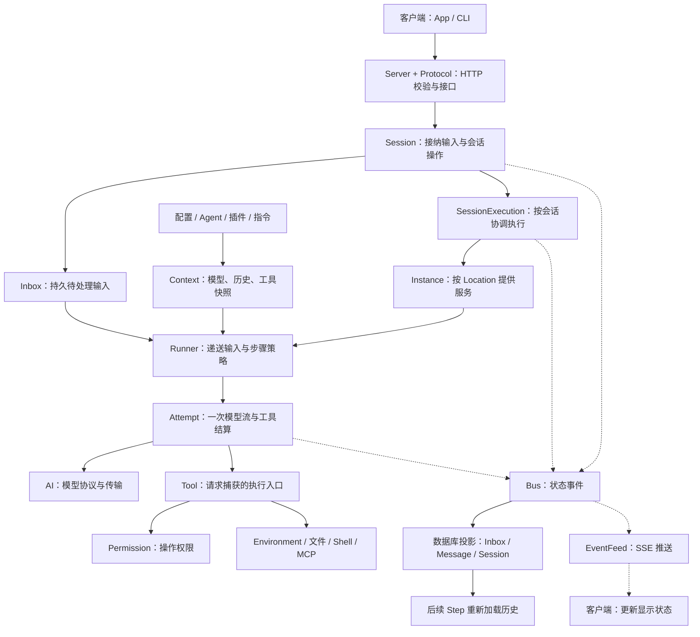

# OpenCode 00｜整体架构：持久会话与服务端执行

[总目录](../README.md) · [公共导览](../START_HERE.md) · [本项目专题](01-agent-loop.md)

**OpenCode 把 Agent 做成一个由服务端持续运行的会话系统。客户端提交输入、观察进度；Core 保存任务状态并组织模型和工具；工作目录对应的实例提供配置、插件、权限和文件操作能力。** 理解这个分工，才能看懂后面为什么需要收件箱、执行协调器和后台 Job。

本组笔记研究固定提交 [`60a212c`](https://github.com/anomalyco/opencode/tree/60a212c0769acd96b446acbadeb790486830f91d)，其根配置版本为 `2.0.27`。这里沿 **V2 的 `packages/core` 实现**讲解：命令入口在 `packages/cli`，HTTP 在 `packages/server`，协议在 `packages/protocol`。这个快照中已经没有旧教程常见的 `packages/opencode/src`；历史设计稿可以解释动机，不能代替当前调用链。[入口依据](https://github.com/anomalyco/opencode/blob/60a212c0769acd96b446acbadeb790486830f91d/package.json#L1-L17)

## 一次修复任务如何完成

以“读取失败测试、修改实现、重新运行测试”为例。先只看正常路径，暂时忽略断线、重启和插件更新。

### 1. HTTP 接收输入，Session 保存待处理工作

客户端向 `POST /api/session/:sessionID/prompt` 提交文字和可选附件。Server 的 `SessionHandler` 将参数交给 Core 的 `Session.Service.prompt`；公开 Session 服务再调用会话操作对象。返回类型是 **收件箱条目**，说明输入已被接纳，不是模型已经回答。[协议](https://github.com/anomalyco/opencode/blob/60a212c0769acd96b446acbadeb790486830f91d/packages/protocol/src/groups/session.ts#L396-L415) · [HTTP 处理器](https://github.com/anomalyco/opencode/blob/60a212c0769acd96b446acbadeb790486830f91d/packages/server/src/handlers/session.ts#L307-L342) · [服务转发](https://github.com/anomalyco/opencode/blob/60a212c0769acd96b446acbadeb790486830f91d/packages/core/src/session.ts#L411-L416)

会话操作先用消息 ID 检查重复输入，准备附件等材料，再调用 `admission.admit` 写入持久收件箱；最后通过 `execution.wake` 通知执行器。数据与通知分开后，网络请求可以结束，服务器继续处理任务。[接纳顺序](https://github.com/anomalyco/opencode/blob/60a212c0769acd96b446acbadeb790486830f91d/packages/core/src/session/session.ts#L145-L175)

### 2. 协调器拥有执行，Instance 提供项目能力

`SessionExecution` 是服务端的全局服务。它按 Session ID 调度，每个会话同一时刻只有一个本进程执行者；不同会话可以并行。开始执行时，它先写入 claim（未完成执行标记），再开始取工作。忙时收到新的 `wake`，协调器记录待检查标记，而不是另开一个竞争同一会话的循环。[协调器](https://github.com/anomalyco/opencode/blob/60a212c0769acd96b446acbadeb790486830f91d/packages/core/src/session/run-coordinator.ts#L71-L145) · [启动与 claim](https://github.com/anomalyco/opencode/blob/60a212c0769acd96b446acbadeb790486830f91d/packages/core/src/session/execution.ts#L76-L117)

执行器从 Session 读取 `location`，通过 `instances.provide(session)` 取得该位置的服务，再调用 Runner。这些服务包括项目配置、Agent 定义、模型、插件、工具注册表、权限和文件环境。配置属于可复用的 Location 实例，不是每次模型请求都从头启动整个项目。[实例服务图](https://github.com/anomalyco/opencode/blob/60a212c0769acd96b446acbadeb790486830f91d/packages/core/src/instance.ts#L59-L114) · [执行器交接](https://github.com/anomalyco/opencode/blob/60a212c0769acd96b446acbadeb790486830f91d/packages/core/src/session/execution.ts#L87-L109)

### 3. Runner 组装模型输入

Runner 等待插件完成激活，然后在步骤边界选择 Agent、当前工具集合和指令。指令来源包括项目规则、Skill、MCP 和其他已注册材料。初始指令可用以后，收件箱里的输入才被递送到会话历史；接着加载模型与本轮历史。[上下文选择](https://github.com/anomalyco/opencode/blob/60a212c0769acd96b446acbadeb790486830f91d/packages/core/src/session/context.ts#L121-L178) · [先准备、后递送](https://github.com/anomalyco/opencode/blob/60a212c0769acd96b446acbadeb790486830f91d/packages/core/src/session/runner/llm.ts#L163-L179)

这次请求使用的是**从完整会话记录中选出的模型视图**：过长历史可能已经被摘要或原生压缩窗口替代；当前工具定义和执行函数也一起被捕获。`SessionModelRequest` 再组织系统指令、消息、模型路由和请求钩子。[Step 请求组装](https://github.com/anomalyco/opencode/blob/60a212c0769acd96b446acbadeb790486830f91d/packages/core/src/session/runner/llm.ts#L206-L269)

### 4. Attempt 消费模型流，并执行完整工具调用

`runStep` 调用 `SessionStep.attempt`。Attempt 使用 `LLMClient.stream` 向模型请求输出，并把模型事件转换成会话事件。收到完整的本地 `tool-call` 后，先发布工具调用记录，再启动工具；服务商已执行的工具不会被本地再执行一遍。

下面的原码保留了完整顺序；`// 笔记：` 是新增的中文教学注释，解释每次交接的责任，其他原代码行保持不变。

<!-- annotated-source: https://github.com/anomalyco/opencode/blob/60a212c0769acd96b446acbadeb790486830f91d/packages/core/src/session/runner/step.ts#L125-L138 -->
```ts
          // 笔记：先完成事件发布，再启动工具，历史中不会先出现结果而没有调用记录。
          yield* publisher.publish(event)
          // 笔记：只有完整的本地调用进入执行；providerExecuted 表示服务商已经代为处理。
          if (event.type !== "tool-call" || event.providerExecuted) return
          toolRuns.push({
            call: event,
            fiber: yield* Effect.uninterruptibleMask((restore) =>
              // 笔记：工具工作允许被取消；返回后，结果缩短与结算仍受外层收尾保护。
              restore(executeTool(event)).pipe(
                Effect.flatMap(toolOutput.truncate),
                Effect.flatMap((outcome) => publisher.toolExecution(event.id, event.name, outcome)),
                Effect.catchTag("Tool.Error", (error) =>
                  publisher.failTool(event.id, toSessionError(error), error.metadata).pipe(Effect.asVoid),
                ),
              ),
            ).pipe(Effect.forkScoped),
          })
```

这里的 `executeTool` 使用本次请求捕获的实现，可能直接调用工具，也可能进入 Code Mode，由生成的代码组合多个工具。读文件、写文件、运行测试最终落到 Environment、文件操作或 Shell 服务；修改文件前，具体工具会请求权限。工具返回的模型内容成为会话历史的一部分。[执行入口](https://github.com/anomalyco/opencode/blob/60a212c0769acd96b446acbadeb790486830f91d/packages/core/src/tool.ts#L263-L284) · [写文件前检查](https://github.com/anomalyco/opencode/blob/60a212c0769acd96b446acbadeb790486830f91d/packages/core/src/tool/plugin/write.ts#L64-L87)

### 5. 工具结果进入下一请求，最终结算本轮

Attempt 会等模型流结束并结算已经启动的工具。如果模型需要根据工具结果继续，它返回 `Completed({ needsContinuation: true })`，Runner 进入下一 Step，重新加载包含工具结果的历史，再请求模型。于是“读测试 → 修改 → 跑测试 → 总结”可以跨越多个 Step；没有一个单独的函数提前知道全部步骤。[等待工具](https://github.com/anomalyco/opencode/blob/60a212c0769acd96b446acbadeb790486830f91d/packages/core/src/session/runner/step.ts#L144-L157) · [继续条件](https://github.com/anomalyco/opencode/blob/60a212c0769acd96b446acbadeb790486830f91d/packages/core/src/session/runner/step.ts#L277-L290) · [外层循环](https://github.com/anomalyco/opencode/blob/60a212c0769acd96b446acbadeb790486830f91d/packages/core/src/session/runner/llm.ts#L188-L195)

模型不再要求继续，且没有待接手输入时，Runner 返回完成。协调器收尾，`SessionExecution` 发布成功终态并清除 claim；投影器写入 idle 标记，标识这轮工作结束。**执行成功表示流程正常结束；测试是否通过，仍要看工具结果和任务验收。** [执行结算](https://github.com/anomalyco/opencode/blob/60a212c0769acd96b446acbadeb790486830f91d/packages/core/src/session/execution.ts#L119-L148) · [idle 投影](https://github.com/anomalyco/opencode/blob/60a212c0769acd96b446acbadeb790486830f91d/packages/core/src/session/projector.ts#L411-L440)

### 6. 数据库与界面消费同一组状态变化

前面的输入、模型输出和工具状态经由 Bus 发布。对于持久事件，Bus 在数据库事务中运行投影器，更新收件箱、消息和会话状态；提交后再交给订阅者。Server 的 `EventFeed` 将公开事件编码为 SSE（服务器向客户端持续推送事件的连接），经独立连接送给客户端。Solid 数据层收到文本增量、工具成功和执行终态等事件，更新页面使用的状态。[事务投影](https://github.com/anomalyco/opencode/blob/60a212c0769acd96b446acbadeb790486830f91d/packages/core/src/bus.ts#L395-L440) · [SSE 入口](https://github.com/anomalyco/opencode/blob/60a212c0769acd96b446acbadeb790486830f91d/packages/server/src/handlers/event.ts#L8-L35) · [客户端更新](https://github.com/anomalyco/opencode/blob/60a212c0769acd96b446acbadeb790486830f91d/packages/client/src/solid/data.ts#L910-L1055)

要区分两种“保存”：**消息等业务投影会持久更新；完整事件载荷是否额外写入事件表，由 `events.persist` 控制，默认未开启。** 因此不能把所有部署都理解为默认保留完整事件日志的事件溯源系统。SSE 本身也是实时通道，重新连接不等于补齐漏掉的全部事件。[配置默认值](https://github.com/anomalyco/opencode/blob/60a212c0769acd96b446acbadeb790486830f91d/packages/core/src/bus.ts#L198-L204) · [事件表写入条件](https://github.com/anomalyco/opencode/blob/60a212c0769acd96b446acbadeb790486830f91d/packages/core/src/bus.ts#L400-L430) · [Server 配置接入](https://github.com/anomalyco/opencode/blob/60a212c0769acd96b446acbadeb790486830f91d/packages/server/src/routes.ts#L114-L121)

## 模块边界与依赖方向

下图是前面调用链的教学整理。实线表示调用或数据交接，虚线表示事件流；没有展开每一个插件和基础服务。



这套分层最有价值的地方，是把三个问题交给不同模块：**接口是否接收到工作，由 Session 回答；现在该执行哪一步，由 Runner 回答；外部世界是否允许、怎样完成操作，由权限与工具服务回答。** UI 负责展示这些结果，不直接管理模型循环的寿命。

图中的 Location 指工作目录与可选工作空间标识。一个 Session 持久记录自己在哪里工作；Instance 根据位置提供能力。移动会话或重建实例时，Runner 可返回 `Moved` / `Reloaded`，全局执行器重新取得位置服务并继续，因此它不能永久抓住第一次加载的目录配置。[重新取得实例](https://github.com/anomalyco/opencode/blob/60a212c0769acd96b446acbadeb790486830f91d/packages/core/src/session/execution.ts#L87-L109)

## Session、Turn、Step、Attempt 与 Job

这些名字描述的是不同层次。用同一个“任务”指代它们，最容易把重试和取消讲错。

| 对象 | 在这次修复中的含义 | 谁负责、保留什么 |
|---|---|---|
| Agent 定义 | 当前选用的角色、模型偏好、权限和步数限制 | Location 内的 Agent 服务；它本身不是一个正在运行的线程 |
| Session | 这段持续对话及其工作位置 | 数据库中的会话、消息投影保存状态，SessionStore 提供读取；子 Agent 也用独立 Session |
| Turn | 上一个 idle 标记之后、这次 idle 之前的一轮工作 | 可以包含运行中补充的输入；服务关闭后恢复可继续同一 Turn |
| Execution | 协调器在本进程拥有的一段忙碌期 | 一个执行 Fiber，可能包含多次 drain；不等于跨重启存在的线程 |
| Step | Runner 组织的一次逻辑模型工作 | 组装请求、判断压缩、管理重试与后续步骤 |
| Attempt | Step 中一次实际模型流及其工具结算 | 读取流、启动本地工具、记录结果，返回重试或继续等 Outcome |
| Job | 需要等待、转后台或交付结果的运行记录 | 可跟踪子会话或 Shell 工作；不会替代 Session 的输入接纳 |

Turn 的边界有明确源码定义：[idle 消息](https://github.com/anomalyco/opencode/blob/60a212c0769acd96b446acbadeb790486830f91d/packages/schema/src/session-message.ts#L284-L295)。Step 与 Attempt 是[嵌套的执行责任](https://github.com/anomalyco/opencode/blob/60a212c0769acd96b446acbadeb790486830f91d/packages/core/src/session/runner/llm.ts#L205-L217)，不能假定一条 assistant 消息、一轮 Turn 和一次 HTTP 请求总是一一对应。

例如第一次请求还没输出就失败，可以重试同一个 Step；如果已有输出，后续 Attempt 可能换 assistant 消息 ID 并接着写。已经在运行的子会话，也可能复用同一个 Job，但新要求仍须先进入它的收件箱。

## Effect Scope：谁启动，谁负责结束

读源码中的 `yield*` 时，可以把它理解为“运行这项工作并接住结果或失败”；`Layer` 负责装配依赖；`Fiber` 是运行中的异步工作；`Scope` 规定这些工作与资源何时清理。这里重要的不是背 API，而是看异步工作附着在哪里。

| 所有者 | 持有的工作或资源 | 结束时的行为 |
|---|---|---|
| 服务端全局服务 | SessionExecution、协调器、Job、SubagentJob | 不随单次 HTTP 请求结束；服务退出后只能依靠持久状态重建工作 |
| Location 实例 | 配置、插件、工具、权限、上下文服务 | 位置关闭会清理这些服务；Runner 在边界检查实例状态并交回重载结果 |
| 插件 activation Scope | 插件注册与相关监听 | 卸载时关闭 Scope，撤销其注册；不会接管全局后台 Job 的生命周期 |
| Attempt 的 Scope | 本次快照工作、工具 Fibers | 取消时中断关联工作，并完成必要的工具和步骤结算 |
| 前台调用者 / 后台观察者 | 等待子 Agent 的结果 | 前台中断会请求取消子会话与 Job；转后台后由全局观察者负责交付 |

直接看后台观察者的关键三行，就能辨认它的归属：

<!-- annotated-source: https://github.com/anomalyco/opencode/blob/60a212c0769acd96b446acbadeb790486830f91d/packages/core/src/session/subagent-job.ts#L34-L41 -->
```ts
    yield* Effect.gen(function* () {
      // 笔记：观察者等待 Job 结果，再把完成消息递送给父会话。
      const info = (yield* jobs.wait({ id: recovery.childSessionID })).info
      if (info) yield* SubagentCompletion.deliver(sessions, jobs, { ...info, recovery })
    }).pipe(
      Effect.ensuring(Effect.sync(() => notifications.delete(key))),
      // 笔记：挂在全局服务的 Scope，启动它的工具或插件结束后仍有人等待。
      Effect.forkIn(scope, { startImmediately: true }),
      Effect.setContext(context),
    )
```

这段代码保证的是**同一进程内的生命周期归属**。跨重启还需要 Job 保存恢复信息和通知 ID；子会话完成后的通知被接纳，才清除待交付标记。不能从 `forkIn` 推导出进程崩溃后内存中的 Fiber 还活着。[全局服务绑定](https://github.com/anomalyco/opencode/blob/60a212c0769acd96b446acbadeb790486830f91d/packages/core/src/session/subagent-job.ts#L20-L26) · [Job 持久恢复格式](https://github.com/anomalyco/opencode/blob/60a212c0769acd96b446acbadeb790486830f91d/packages/core/src/job.ts#L9-L37)

用户按停止时，协调器先接受中断，随后异步清理；需要等旧执行真正收尾，用 `awaitSettlement`，需要等包括后续执行在内的会话空闲，用 `awaitIdle`。服务关闭则保留 claim，受管理的服务下次启动扫描恢复；用户停止会清除 claim。恢复继续的是持久记录表达的工作意图，不能保证外部操作只发生一次。[取消与等待](https://github.com/anomalyco/opencode/blob/60a212c0769acd96b446acbadeb790486830f91d/packages/core/src/session/run-coordinator.ts#L147-L194) · [启动恢复安装点](https://github.com/anomalyco/opencode/blob/60a212c0769acd96b446acbadeb790486830f91d/packages/server/src/process.ts#L96-L111)

## 插件和权限如何嵌入主流程

插件的作用是向 Location 的各个领域服务注册能力或修改规则，例如工具、Agent 和请求钩子。当前实现用可重放的 `State` 变换构造有效状态：多个注册按顺序应用，插件卸载时移除自己拥有的变换，再从剩余注册重新计算。这样不需要猜“被卸载插件之前覆盖了什么”。这段实现应从 `State` 与 `Plugin` 读起，不应把历史 Catalog 方案当作现行架构。[注册生命周期](https://github.com/anomalyco/opencode/blob/60a212c0769acd96b446acbadeb790486830f91d/packages/core/src/state.ts#L5-L24) · [插件 Scope](https://github.com/anomalyco/opencode/blob/60a212c0769acd96b446acbadeb790486830f91d/packages/core/src/plugin.ts#L20-L77)

权限检查有两个位置。准备请求时，工具快照会过滤被整体禁用的能力，减少模型看到的入口；真正执行时，写文件等工具再根据具体资源调用 `permission.assert`，读取会话和 Agent 当前规则，必要时等待用户决定。前者控制可见能力，后者控制这一次操作；插件更新后的新请求会取得新快照，已发出的请求仍持有原实现。[工具快照](https://github.com/anomalyco/opencode/blob/60a212c0769acd96b446acbadeb790486830f91d/packages/core/src/tool.ts#L225-L235) · [执行时规则](https://github.com/anomalyco/opencode/blob/60a212c0769acd96b446acbadeb790486830f91d/packages/core/src/permission.ts#L158-L188)

这仍是应用层协议。工具注册表不会自动替任意插件补上权限检查；可信插件必须正确使用这些服务。Environment 提供操作实现，也不能仅凭这个名字就推断具备操作系统级隔离。

## 源码阅读顺序与专题连接

先沿正常路径阅读前四行，建立数据如何流动的印象，再选择需要深入的异常专题。

| 阅读目标 | 先读的文件 / 函数 | 对应笔记 |
|---|---|---|
| 输入何时算被接收 | `handlers/session.ts` → `session/session.ts: prompt` → `inbox.ts` | [01 执行循环](01-agent-loop.md) |
| 一次请求看见哪些材料 | `session/context.ts` → `runner/llm.ts: advanceToStep / runStep` | [02 上下文管理](02-context-session.md) |
| 工具如何从描述变成操作 | `runner/step.ts: attempt` → `tool.ts: snapshot` → 具体工具 | [03 工具执行](03-tools-sandbox.md) |
| 输出如何保存并送到页面 | `publish-llm-event.ts` → `bus.ts` / `projector.ts` → `event-feed.ts` | [08 事件推送](08-observability-evaluation.md) |
| 模型中途失败后重做哪里 | `runner/step.ts: Outcome` → `runner/llm.ts: runStep` | [04 模型通信](04-llm-streaming.md) |
| 插件变化影响哪些请求 | `state.ts` → `plugin.ts` → `tool.ts` | [05 扩展机制](05-extension-architecture.md) |
| 子任务与父任务怎样交接 | `tool/plugin/subagent.ts` → `subagent-job.ts` → `job.ts` | [06 子 Agent 编排](06-task-orchestration.md) |
| 重启后继续什么、放弃什么 | `session/execution.ts` → `execution/restart.ts` | [07 任务恢复](07-persistence-reliability.md) |

## 架构自测

1. HTTP 返回成功、用户关闭页面，此时谁保存输入，谁继续执行？
2. 模型已调用读文件工具，为什么下一次请求能用到读取结果？把结果只发给 UI 是否足够？
3. 同一子会话已有 Job 在运行，再次启动 Job 能否代替提交补充要求？
4. 插件卸载、用户取消、服务重启，分别应该清理或保留什么？

<details>
<summary>参考答案</summary>

1. Session 的收件箱保存输入，服务器全局 SessionExecution 协调执行，Location 的 Runner 实际推进。页面连接不是执行所有者。
2. 工具调用和结果经 Bus 更新消息投影；Runner 重新加载历史构建下一请求。只更新 UI，模型看不到结果。
3. 不能。已有 Job 可被复用，新的运行函数可能不再执行；补充输入必须先走 Session 接纳流程。
4. 插件卸载撤销自己的注册；用户取消结束当前意图并清除恢复 claim；服务关闭保留未完成意图，下一启动按持久记录恢复。全局后台观察者可跨插件生命周期，但不能跨进程保留原 Fiber。

</details>

本篇依据固定提交逐段追踪了上述实现；代码块中的 `// 笔记：` 是教学注释，其他原码保持不变。本轮未运行上游完整测试，也没有做真实服务崩溃实验；[架构复核记录](../research/reread/opencode-architecture.md)列出证据与修正范围。
